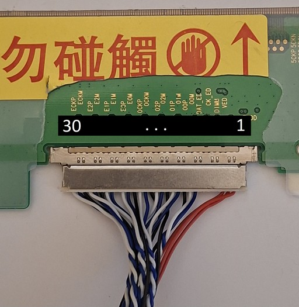
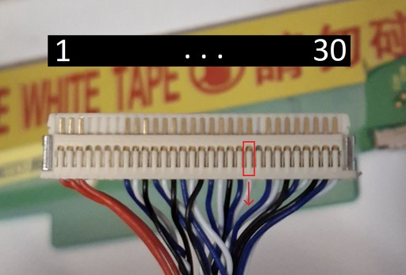

← [Back to README](../README.md)

← [Back to Screen](screen.md)

# EDP to LVDS

## The JX Board

Digging up info on this was a very exhausting task, but eventually these eeworld forum posts helped gain traction:

- [Low BOM cost EDP to LVDS conversion solution CS5211](docs/eeworld_JX_EDP_LVDS_CS5211_1.pdf)
- [CS5211/eDP to LVDS converter design circuit diagram](docs/eeworld_JX_EDP_LVDS_CS5211_2.pdf)

After arriving at [Shenzhen Jingxin Quartz Technology](docs/specs_JX_EDP_LVDS_CS5211.pdf)'s design, I ordered one. It has a 64kbit EEPROM onboard containing the firmware: [Shenzhen Hangshun Chip Technology HK24C64](docs/specs_SHCT_HK24C64.pdf).

## Firmware and EDID

The firmware can be dumped with an Arduino using the SDA/SCL pins:

```
./arduino.sh Screen/DumpROM --quiet > Screen/DumpROM/dump_CS5211.txt
```

The first 1024 bits of the firmware are the EDID repeated 16 times. This is because the [CS5211](docs/specs_CapStone_CS5211.pdf) supports 16 different EDID slots, selectable by pin. The factory-flashed [EDID](DumpROM/edid_dump_CS5210.csv) was for a 1920x1080 panel.

Since I was working with the LTN141P4 I needed its EDID. I reconstructed the [EDID](docs/edid_Samsung_LTN141P4-L03.csv) from its [datasheet](docs/specs_14inch_Samsung_LTN141P4-L03.pdf) and noticed some discrepancies in the note fields of the red and green high bits. So I also wrote a script to sanity check EDIDs:

```
python Screen/check_edid.py <edid.csv>
```

I also dumped my purchased panel's EDID by putting it into my ThinkPad T60 and booting it:

```
xxd -p /sys/class/drm/card1-LVDS-1/edid
```

The result is this [EDID](DumpROM/edid_dump_LTN141P4.csv), converted with `python Screen/dump_to_csv.py`. It doesn't appear to be a genuine Samsung panel, but it looks and works like a drop-in replacement so far, and it is hard to get your hands on unused new old hardware like this, so I'll take the win. There are some tiny deviations in a few fields between the dumped EDID and the datasheet specs, but we will get to this later.

## Wiring the Panel

The mating connector on the panel is a JAE FI-X30M — a 30-pin connector that was standard for panels of this era — so the JX driver board came with a matching cable. However the pinout is not standard, so the connector needs to be rewired:



Luckily the plastic pins of the mating connector can be gently lifted and rearranged relatively easily:



| LTN # | LTN Pin | JX Pin |
|---|---|---|
| 1 | GND | GND |
| 2 | VCC | VCC |
| 3 | VCC | VCC |
| 4 | VEEDID | NC |
| 5 | NC | NC |
| 6 | CLKEDID | NC |
| 7 | DATAEDID | NC |
| 8 | O_RxIN0- | RO0- |
| 9 | O_RxIN0+ | RO0+ |
| 10 | GND | GND |
| 11 | O_RxIN1- | RO1- |
| 12 | O_RxIN1+ | RO1+ |
| 13 | GND | GND |
| 14 | O_RxIN2- | RO2- |
| 15 | O_RxIN2+ | RO2+ |
| 16 | GND | GND |
| 17 | O_RxCLK- | ROC- |
| 18 | O_RxCLK+ | ROC+ |
| 19 | GND | GND |
| 20 | E_RxIN0- | RE0- |
| 21 | E_RxIN0+ | RE0+ |
| 22 | GND | GND |
| 23 | E_RxIN1- | RE1- |
| 24 | E_RxIN1+ | RE1+ |
| 25 | GND | GND |
| 26 | E_RxIN2- | RE2- |
| 27 | E_RxIN2+ | RE2+ |
| 28 | GND | GND |
| 29 | E_RxCLK- | REC- |
| 30 | E_RxCLK+ | REC+ |
| - | NC | RO3- |
| - | NC | RO3+ |
| - | NC | RE3- |
| - | NC | RE3+ |

The pinout already reveals that this chip does not support EDID passthrough, so plugging it in won't produce a picture until the correct EDID is forced — either with [Custom Resolution Utility](https://customresolutionutility.net/) on Windows, or the equivalent shell magic on Linux.

## Flashing the EDID

To make the eDP source recognize the correct EDID, it needs to be flashed to the EEPROM. See [Patching](#patching) below for the full process.

## Color Format Problem

And voilà, we have a picture! Both the datasheet and the dumped panel EDID works with correct aspect ratio and geometry, but severe color artifacts and posterization in a very weird but consistent pattern. It turns out the factory firmware uses VESA 24-bit format, while the panel uses 18-bit.

The 18-bit format is identical between VESA and JEIDA, and JEIDA 24-bit would also work since it is backwards compatible — it simply drops the least significant bits. The color artifacts are caused by bits being read in the wrong significance order. That's why pure solid colors like #FF0000 display correctly (bit significance doesn't matter when all bits are the same), but in-between colors are heavily skewed.

The fix is to switch the firmware to JEIDA convention. The Chinese electronics forums — particularly CSDN — had the most useful material on this, but they're largely inaccessible without a Chinese phone number. Eventually got unblocked by having someone from Fiverr help navigate them. The key resource was a [comprehensive CSDN guide](https://blog.csdn.net/q5r6s7/article/details/153856405) on customizing CS5211 EEPROM firmware, translated in full: [csdn_CS5211.md](docs/csdn_CS5211.md). Combined with analysis of config tool output, the firmware format is now fully understood.

## Firmware Format

The 8 kB EEPROM image has two regions of interest:

**EDID region (0x0000–0x07FF):** The first 1024 bytes are the EDID repeated 16 times — one copy per slot, since the CS5211 supports 16 EDID slots selectable by pin.

**Slot configuration region (0x1010–0x108F):** 16 slots × 16 bytes each. The layout per slot:

| Offset | Value | Meaning |
|---|---|---|
| +0 | `0x01` | Dual-channel flag |
| +3 | mode byte | Bit depth + LVDS mapping standard |

The mode byte at offset +3 encodes both bit depth and VESA/JEIDA:

| Mode | b3 |
|---|---|
| 6-bit JEIDA | `0x07` |
| 6-bit VESA | `0x03` |
| 8-bit JEIDA | `0x05` |
| 8-bit VESA | `0x01` |

**Firmware checksum (0x0FFA–0x0FFD):** A 4-byte big-endian checksum covering the non-EDID firmware body. The value is fixed per mode (all 16 slots uniform) and does not depend on the EDID content:

| Mode | Checksum |
|---|---|
| 6-bit JEIDA | `0x5DA247C5` |
| 6-bit VESA | `0x9C58E855` |
| 8-bit JEIDA | `0xDA960552` |
| 8-bit VESA | `0x1B6CAAC2` |

Without the correct checksum the chip rejects the firmware entirely — this was the missing piece.

## Patching

[patch_cs5211.py](DumpROM/patch_cs5211.py) handles the full patch in one shot. The mode is set at the top of the script:

```python
MODE_8BIT = True
MODE_VESA = False
```

Run it against the dumped firmware and an EDID CSV:

```
python Screen/DumpROM/patch_cs5211.py Screen/DumpROM/dump_CS5211.txt Screen/DumpROM/edid_dump_LTN141P4.csv
```

What it does:
1. Fixes the EDID checksum byte (`0x7F`) before writing
2. Detects how many EDID copies are at the start of the ROM and replaces all of them
3. Writes the mode byte (`b3`) into all 16 slots at `0x1010`
4. Writes the corresponding firmware checksum at `0x0FFA`
5. Outputs a new file alongside the input, e.g. `dump_CS5211_patched_8bit_jeida.txt`

Then flash:

```
./arduino.sh Screen/FlashROM
```
